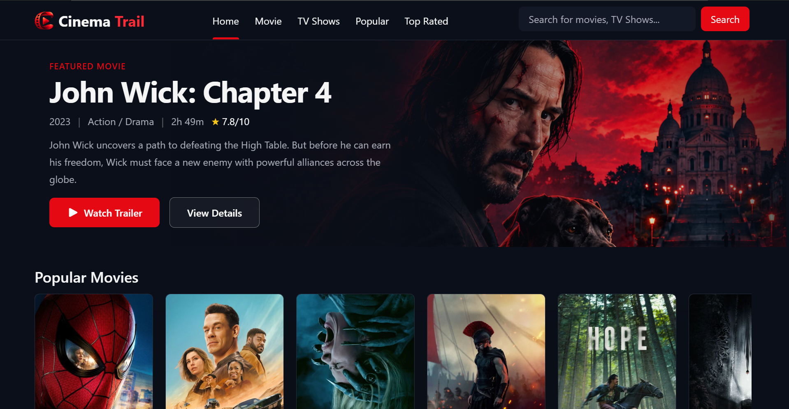
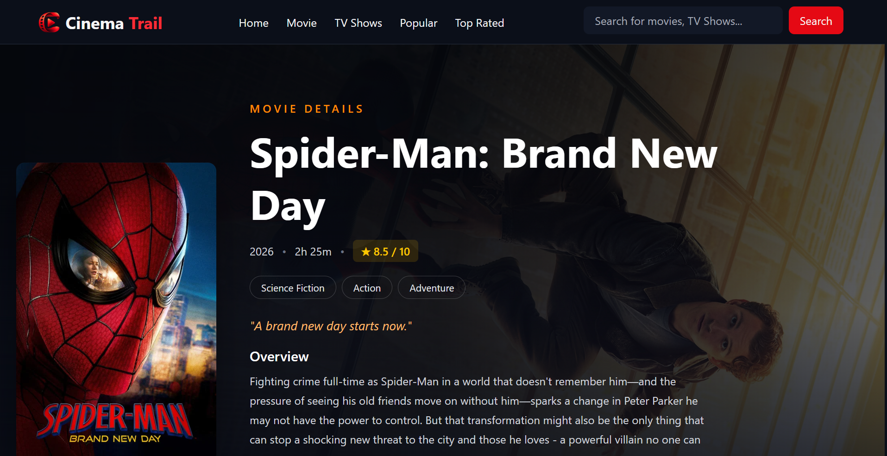
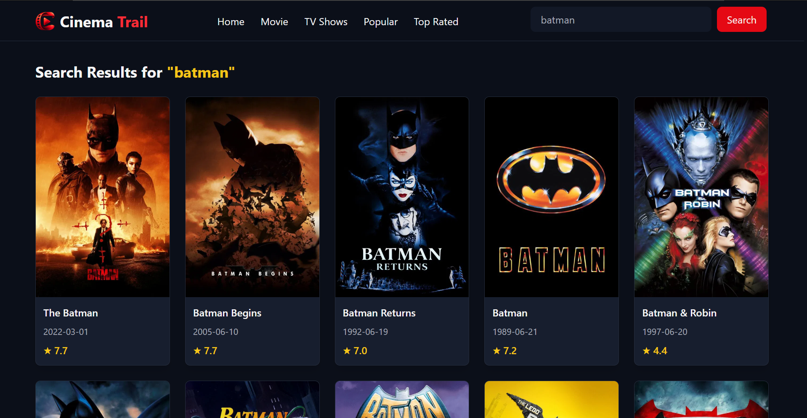

# 🎬 CinemaTrial

### Discover movies. Explore stories. Find your next watch.

CinemaTrial is a movie discovery web application built with React that allows users to explore movies, search for titles, discover popular and top-rated films, and view detailed information about individual movies.

The application uses the TMDB API to fetch movie and TV show data and presents it through a clean, interactive interface.

## ✨ Features

- 🔍 **Movie Search** — Search for movies by title.
- 🎬 **Movie Discovery** — Browse movie collections through dedicated pages.
- 🔥 **Popular Movies** — Explore popular movies.
- ⭐ **Top-Rated Movies** — Discover highly rated films.
- 📺 **TV Shows** — Explore trending TV shows.
- 🎞️ **Movie Details** — View detailed information about selected movies.
- 👥 **Cast Information** — Explore cast members and their profile images.
- 🧭 **Dynamic Routing** — Navigate between pages and open individual movie details.
- 🎨 **Modern UI** — Browse movies through visually appealing cards and sections.

## 🛠️ Tech Stack

| Technology | Purpose |
|---|---|
| React | Building reusable UI components |
| JavaScript (ES6+) | Application logic |
| Tailwind CSS | Styling and responsive layouts |
| React Router | Client-side routing and navigation |
| Axios | Making HTTP requests |
| TMDB API | Fetching movie and TV show data |
| Vite | Development server and build tool |

## 📸 Screenshots

### Homepage


### Movie Details


### Search Movies


## 🚀 Getting Started

Follow these steps to run CinemaTrial locally.

### Prerequisites

- Node.js
- npm
- A TMDB account and API Read Access Token

### 1. Clone the Repository

```bash
git clone https://github.com/salim241/CinemaTrail.git
```

### 2. Navigate to the Project Directory

```bash
cd CinemaTrial
```

### 3. Install Dependencies

```bash
npm install
```

### 4. Configure Environment Variables

Create a `.env` file in the project root directory and add your TMDB API Read Access Token:

```env
VITE_TMDB_READ_ACCESS_TOKEN=your_tmdb_read_access_token
```

Replace `your_tmdb_read_access_token` with your actual token.

**Important:** Never commit your `.env` file to GitHub.

Ensure your `.gitignore` includes:

```gitignore
.env
.env.*
!.env.example
```

### 5. Start the Development Server

```bash
npm run dev
```

Vite will display a local development URL in your terminal. Open that URL in your browser to use CinemaTrial.

## 📂 Project Structure

```text
CinemaTrial/
├── public/
├── src/
│   ├── assets/
│   ├── components/
│   │   ├── Button.jsx
│   │   ├── Footer.jsx
│   │   ├── Hero.jsx
│   │   ├── MovieCard.jsx
│   │   ├── MovieDetails.jsx
│   │   ├── MovieSection.jsx
│   │   ├── Navbar.jsx
│   │   ├── PopularMovies.jsx
│   │   ├── PosterSlider.jsx
│   │   ├── SearchArea.jsx
│   │   ├── SearchBox.jsx
│   │   ├── SearchedMovies.jsx
│   │   └── TopRatedMovies.jsx
│   ├── pages/
│   │   ├── Home.jsx
│   │   ├── MovieDetailsPage.jsx
│   │   ├── Movies.jsx
│   │   ├── Popular.jsx
│   │   ├── SearchPage.jsx
│   │   ├── TopRated.jsx
│   │   └── TvShow.jsx
│   ├── App.css
│   ├── App.jsx
│   ├── index.css
│   └── main.jsx
├── .env
├── .gitignore
├── eslint.config.js
├── index.html
├── package-lock.json
├── package.json
├── README.md
└── vite.config.js
```

## 🌐 API Integration

CinemaTrial uses the **TMDB API** to retrieve movie and TV show information.

The application makes HTTP requests to fetch data such as movie titles, posters, ratings, release dates, movie details, and cast information.

Movie posters and cast profile images are loaded using TMDB's image service.

For API documentation, visit the [TMDB Developer Documentation](https://developer.themoviedb.org/docs).

This product uses the TMDB API but is not endorsed or certified by TMDB.

## 📚 Key Learnings

Building CinemaTrial provided hands-on practice with:

- Creating reusable React components.
- Passing data between components using props.
- Managing component state with React hooks.
- Fetching API data using Axios and `useEffect`.
- Implementing dynamic routes using React Router.
- Handling asynchronous API requests.
- Managing environment variables in a Vite application.
- Styling interfaces using Tailwind CSS.
- Debugging API requests and component behavior.

## 🔮 Future Improvements

Potential improvements for future versions include:

- Add a personal movie watchlist.
- Implement genre-based filtering.
- Add pagination or infinite scrolling.
- Improve loading states and error handling.
- Deploy the application for public access.

## 👨‍💻 Author

**Salim Ali**

- GitHub: [@salim241](https://github.com/salim241)

---

If you find this project interesting, consider giving the repository a ⭐ on GitHub!